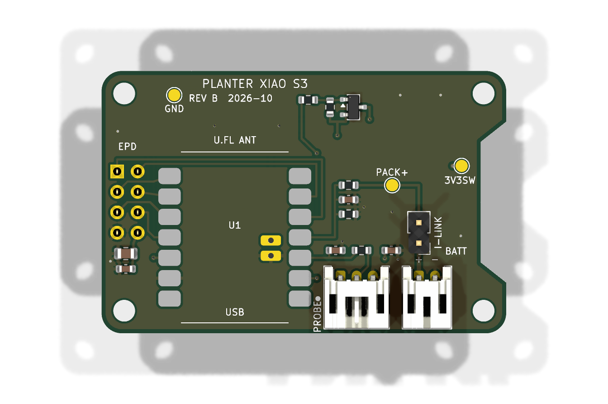
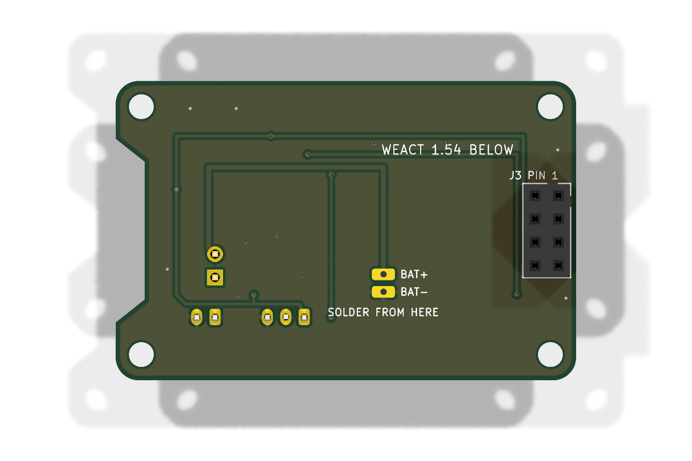

# Planter XIAO carrier - Rev B (PCB, XIAO ESP32-S3)

Rev A's circuit turned into a 2-layer PCB that sits directly behind the WeAct
1.54-inch e-paper module. It carries a Seeed **XIAO ESP32-S3**, **soldered
flat** by its castellations. The land pattern is the plain S3's: the S3 Plus
has more pads and won't fit. The module's underside BAT+/BAT- pads land on
plated pads on the carrier, so the battery needs no flying leads.

Status (2026-10-24): schematic and layout regenerated for the S3 and checked.
ERC clean, DRC clean with **zero** violations, schematic parity clean, 0
unconnected. Nothing has been fabricated, fitted or powered. First-article
gates below.

| Top | Underside (display side) |
|---|---|
|  |  |

## What changed from Rev A

| Item | Rev A (perfboard P1) | Rev B | Why |
|---|---|---|---|
| Module | XIAO ESP32-C6 | **XIAO ESP32-S3 only** | One chip, so the board can use its exact land pattern and underside pads. |
| XIAO mounting | Soldered | **Surface-mounted on its castellations** | Seeed's own XIAO-ESP32-S3-SMD land pattern. Nothing sits under the module. |
| Battery to XIAO | Wires | **Plated BAT+/BAT- pads under U1** | They meet the module's underside pads. Solder from the back through the plated holes, or reflow. |
| Pin map | By C6 GPIO | **Rearranged for the S3 layout** | The display takes the four left-row pins beside its header. D6 (UART0 TX) is left unconnected: the ROM log drives it on every wake. |
| Antenna | C6 ceramic | **S3 U.FL + external antenna** | No copper keep-out is needed, which frees the band above the module for the switch. |
| Test points | 10 | **3** (PACK+, GND, 3V3_SW) | Every other net is on a XIAO castellation, which you can probe at the module's edge. |
| Connectors | TBD | **JST-PH side-entry** S2B (battery) / S3B (probe) | Cables exit the bottom edge, beside the USB-C. |
| Display | Cabled 2x4 | **2x4 female socket on the underside** | The module's own header plugs straight in. |

Electrical values are unchanged: 200k/200k divider + 100 nF, AO3401A high-side
switch with 100k pull-up and 1k gate resistor, 1k + 100 nF on the probe input,
10 uF + 2 x 100 nF on 3V3_SW.

## Pin map (XIAO ESP32-S3)

| XIAO pad | Net | S3 GPIO | Notes |
|---|---|---:|---|
| D0 | spare | 1 | |
| D1 | PERIPH_EN_N (LOW = on) | 2 | R1 holds it high (rail off) through reset and sleep. |
| D2 | MOIST_ADC | 3 | ADC1_CH2. GPIO3 is a JTAG-source strap, sampled only if the eFuse selects it. |
| D3 | VBAT_ADC | 4 | ADC1_CH3 |
| D4 | EPD_BUSY | 5 | Input from reset. |
| D5 | EPD_RST | 6 | |
| D6 | not connected | 43 | UART0 TX: the ROM boot log. |
| D7 | EPD_DC | 44 | UART0 RX: an input from reset. |
| D8 | EPD_CS | 7 | |
| D9 | EPD_SCLK | 8 | SPI goes through the GPIO matrix. The firmware passes the pins to `SPI.begin`. |
| D10 | EPD_MOSI | 9 | |
| BAT+ (underside) | PACK+ | | Plated pad, after JP1. |
| BAT- (underside) | GND | | Plated pad. Also tied by the GND castellation. |

## Assembly

1. SMD passives and Q1 first, then the XIAO.
2. XIAO: line the castellations up with the pads, with USB-C at the board edge
   (pin 1 dot at D0, bottom right). Tack two opposite corners, check alignment,
   then solder all 14 castellations.
3. Turn the board over. Solder BAT+ then BAT- through their plated holes,
   marked on the back silk. Hold the iron on the back pad and feed solder until
   it wicks up to the module's pad. BAT- connects to the planes, so give it more
   heat. With paste and a hot plate or hot air, the two pads reflow with the
   castellations instead.
4. Through-hole parts last: JP1, the JSTs, and J3 on the underside.

Check with a meter before connecting a cell: carrier BAT+ to the module's BAT+
side, and BAT- to GND.

## Mechanical stack

```
   XIAO ESP32-S3 (USB-C at bottom edge, U.FL end up)  ── flat on castellations
   ─────────── Rev B carrier, 50.12 x 32.60 mm, 1.6 mm ───────────
      J3 2x4 female socket (underside) + 4 x M2.5 standoffs, ~11 mm
   ─────────── WeAct 1.54" module (header pins pointing back) ───────────
   ─────────── e-paper panel ───────────
```

- The outline, the M2.5 hole pattern (44.52 x 27.00 mm) and the right-edge FPC
  recess all copy the WeAct board-shape drawing, so the carrier sits exactly
  over the module.
- J3 pin 1 is at (1.93, 12.49) mm from the top-left corner in the top view,
  measured off the drawing. **Check it against a real module before ordering.**
- The XIAO's USB-C sits about 16.5 mm from the left edge. Its receptacle face is
  flush with the bottom edge.
- Standoff length = socket height + header plastic. 8.5 mm socket + 2.5 mm
  plastic ≈ 11 mm. Measure your parts.

## Antenna

The plain XIAO ESP32-S3 has no onboard antenna. It uses the supplied external
antenna on its U.FL, at the module's top end (marked `U.FL ANT`). Leave room in
the enclosure for the pigtail and whip. Keep the whip away from the copper
planes and the panel.

## Battery

Protected P+/P- go to J1 (pin 1 = P+). **JST-PH LiPo polarity is not
standardised: check every pigtail before plugging in.** JP1 is the removable
current-measurement link. After JP1, PACK+ runs on the underside to the plated
BAT+ pad under the module, and on the top side to TP1 and the divider. The
external protection PCB stays with the cell, as in Rev A.

## Files

| File | Purpose |
|---|---|
| `netlist.csv` | Reviewed connectivity. `make_kicad.py` builds the schematic from it. |
| `make_kicad.py` | Writes `planter-carrier-rev-b.kicad_sch` and `Planter.kicad_sym`. |
| `make_pcb.py` | Writes the XIAO footprint and `planter-carrier-rev-b.kicad_pcb`. It takes nets from the schematic's exported netlist, so parity holds by construction. Needs KiCad 10's Python (`pcbnew`), from the macOS bundle or a Linux package. |
| `check.sh` | Regenerates everything. Fails on any ERC, DRC or parity finding. |
| `make_fab.sh` | Gerber/drill zip, top-side CPL and BOM into `build/fab/` (JLCPCB-shaped). |

Both generators are reproducible baselines. If you edit in the KiCad GUI,
commit before re-running them.

The fab zip holds two drill files: `-PTH.drl` (plated holes:
BAT pads, JP1, the JSTs, J3) and `-NPTH.drl` (the M2.5 holes). A Gerber viewer
shows plated pads as solid copper unless it loads the PTH file.

## Firmware

`platformio-rev-b.ini` at the repo root:

```
pio run -c platformio-rev-b.ini -e esp32s3_rev_b -t upload
```

It sets `PLANTER_CARRIER_REV_B`, which selects the Rev B pin map in
`firmware-v2/planter_v2.cpp`. The moisture endpoints are placeholders (the C6
P1 figures) until the S3 is calibrated.

## First-article gates

Carried over from Rev A, plus Rev B items:

1. Before ordering: print the top copper and silk 1:1. Lay a real XIAO
   ESP32-S3 on it and check that the castellations and the module's underside
   BAT+/BAT- pads land on their pads. The BAT pad position comes from Seeed's
   library and is not measured. Lay the print over a real WeAct module and
   check the holes, the J3 pin 1 position and the FPC recess.
2. Check every battery pigtail's polarity against J1 (pin 1 = P+).
3. With USB removed: D3 reads half of PACK+ within resistor tolerance.
   Firmware battery voltage agrees with a DMM within 50 mV after `BATT_TRIM`.
4. 3V3_SW is fully off between wakes. No EPD line is high while it is off.
5. Measure whole-assembly sleep current at JP1.
6. Calibrate dry/wet endpoints on the S3.
7. Check Wi-Fi RSSI at the install site with the enclosure closed and the
   external antenna in its final place.
8. 24-hour soak with repeated Wi-Fi and display updates.
